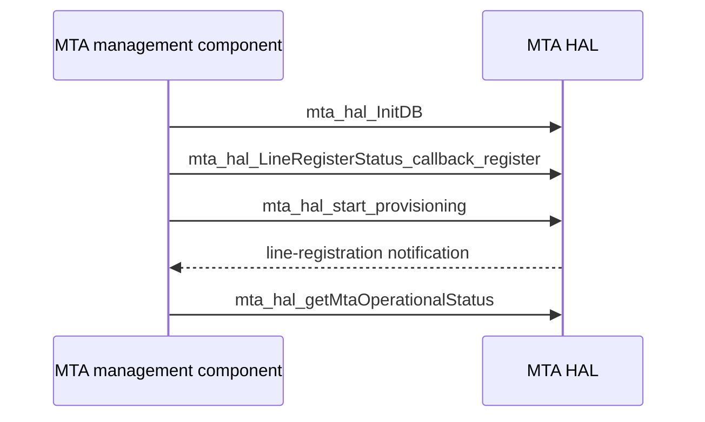

# MTA HAL Specification

## Version History

| Date | Comment | Version |
| --- | --- | --- |
| — | Documentation alignment; no ABI change. | — |

## Acronyms
HAL means Hardware Abstraction Layer; MTA means Multimedia Terminal Adapter; DECT means Digital Enhanced Cordless Telecommunications.

## Description
The MTA management component uses this HAL for voice-device provisioning, line status, diagnostics, DECT, call logs, battery observations, and reset operations.

## Optional Components
DECT, battery hardware, and individual diagnostic facilities are product-dependent.

## Component Runtime Execution Requirements
### Initialization and Startup
Call `mta_hal_InitDB` before dependent operations. Initiate provisioning with `mta_hal_start_provisioning` when required by the product.
### Threading Model
Serialize shared control operations unless the vendor guarantees concurrency.
### Process Model
Use the library in process and coordinate other voice-management writers.
### Memory Model
Callers own supplied output storage except where an individual declaration explicitly specifies allocation. Respect table counts, capacities, and field units.
### Power Management Requirements
Battery and power-saving observations exist; they do not establish a general system power-transition lifecycle.
### Asynchronous Notification Model
`mta_hal_LineRegisterStatus_callback_register` registers line-registration notification. Confirm callback thread and data lifetime before retaining payloads.
### Internal Error Handling
Check each declared result. Do not treat request acceptance as completed provisioning or diagnostics. Reset and log clearing are disruptive/destructive.
### Persistence Model
Follow operation-specific product requirements for configuration and log persistence.

## Nonfunctional Requirements
### Logging and Debugging
Implementations must not log credentials, secrets, security-sensitive information, or other sensitive data. Log operation outcomes rather than payloads.
### Quality Control
Use warning-clean builds, static analysis, memory checks, and hardware-qualified state restoration.
### Licensing
See repository Apache-2.0 notices.
### Build Requirements
Compile against the public header and product implementation; legacy packaging names `libhal_mta.so`.
### Variability Management
Compile and test supported product facilities only.

## Interface API Documentation
The linked header supplies exact signatures, argument directions, structures, bounds, and return contracts.

| Area | Public operations |
| --- | --- |
| Initialization/provisioning | `mta_hal_InitDB`, `mta_hal_start_provisioning`, `mta_hal_getDhcpStatus`, `mta_hal_getConfigFileStatus`, `mta_hal_getLineRegisterStatus`, `mta_hal_getMtaOperationalStatus`, `mta_hal_getMtaProvisioningStatus` |
| Network/lines | `mta_hal_GetDHCPInfo`, `mta_hal_GetDHCPV6Info`, `mta_hal_LineTableGetNumberOfEntries`, `mta_hal_LineTableGetEntry`, `mta_hal_GetServiceFlow`, `mta_hal_LineRegisterStatus_callback_register` |
| Diagnostics | `mta_hal_TriggerDiagnostics`, `mta_hal_GetCALLP` |
| DECT | `mta_hal_DectGetEnable`, `mta_hal_DectSetEnable`, `mta_hal_DectGetRegistrationMode`, `mta_hal_DectSetRegistrationMode`, `mta_hal_DectDeregisterDectHandset`, `mta_hal_GetDect`, `mta_hal_GetDectPIN`, `mta_hal_SetDectPIN`, `mta_hal_GetHandsets` |
| Calls/logs | `mta_hal_GetCalls`, `mta_hal_ClearCalls`, `mta_hal_GetDSXLogs`, `mta_hal_GetDSXLogEnable`, `mta_hal_SetDSXLogEnable`, `mta_hal_ClearDSXLog`, `mta_hal_GetCallSignallingLogEnable`, `mta_hal_SetCallSignallingLogEnable`, `mta_hal_ClearCallSignallingLog`, `mta_hal_GetMtaLog` |
| Battery | `mta_hal_BatteryGetInstalled`, `mta_hal_BatteryGetTotalCapacity`, `mta_hal_BatteryGetActualCapacity`, `mta_hal_BatteryGetRemainingCharge`, `mta_hal_BatteryGetRemainingTime`, `mta_hal_BatteryGetNumberofCycles`, `mta_hal_BatteryGetPowerStatus`, `mta_hal_BatteryGetCondition`, `mta_hal_BatteryGetStatus`, `mta_hal_BatteryGetLife`, `mta_hal_BatteryGetInfo`, `mta_hal_BatteryGetPowerSavingModeStatus` |
| Resets | `mta_hal_Get_MTAResetCount`, `mta_hal_Get_LineResetCount`, `mta_hal_devResetNow` |

### Theory of Operation and Key Concepts
Provisioning, line registration, operational state, and battery condition are different observations. A later table fetch may differ from an earlier entry count.

### Sequence Diagram

## Source References
- [mta_hal.h](https://github.com/rdkcentral/rdkb-halif-mta/blob/develop/include/mta_hal.h)
